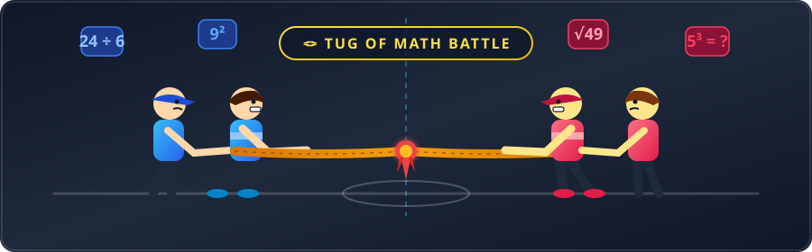
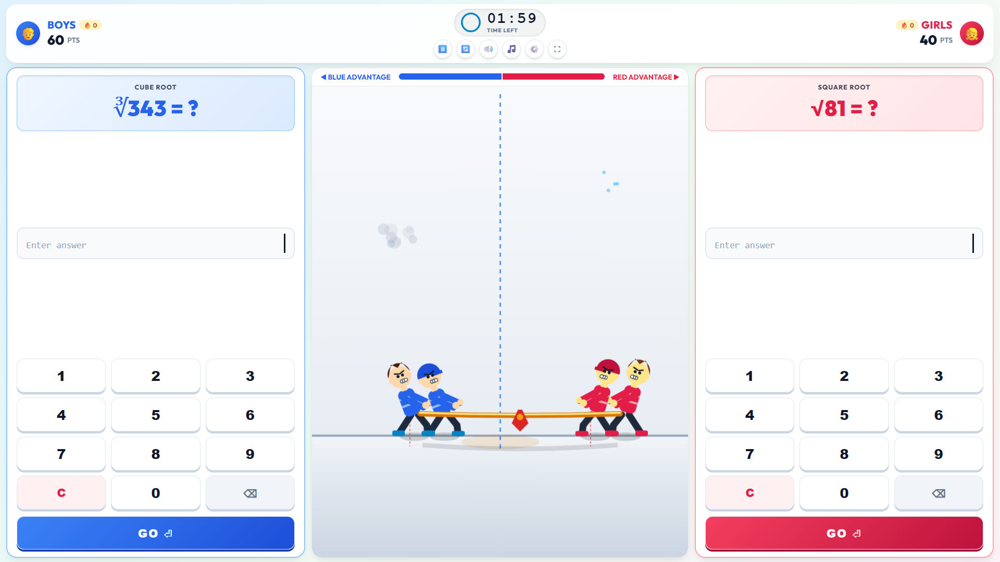
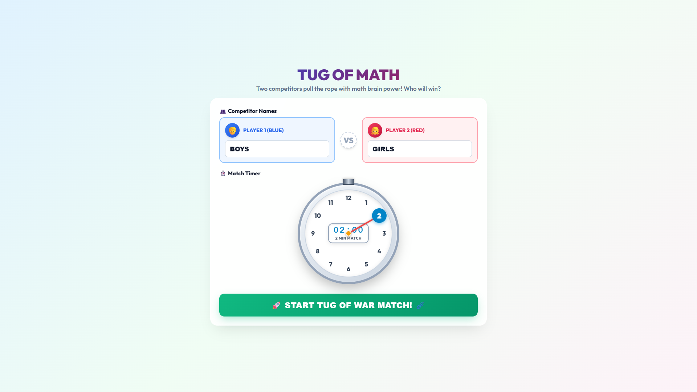
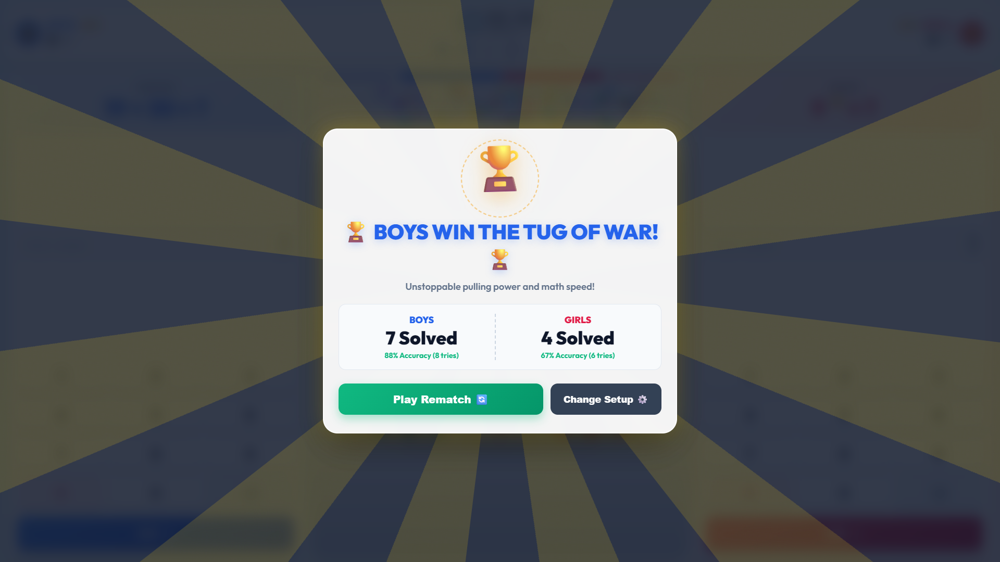

<div align="center">

# 🪢 TUG OF MATH
### *Real-Time 2-Player Animated Tug-of-War Math Battle*

[](https://opensource.org/licenses/MIT)
[](#)
[](#)
[](#)
[](#)
[](#)
[](#)

<br/>

<!-- Animated Tug-of-War Vector Banner -->


<p align="center">
  <b>A competitive classroom and smartboard quiz battle where math speed equals physical rope pulling power!</b><br/>
  Two players face each other solving unlimited math problems. In the middle, two animated teams heave-ho and yank the rope in real-time. Whoever solves faster pulls the opposition across the line!
</p>

[🎮 Quick Start](#-quick-start) •
[✨ Key Features](#-key-features) •
[📸 Screenshots](#-screenshots) •
[📱 Mobile & Tablet Play](#-play-on-phone--tablet) •
[🧠 Math Operations](#-math-engine) •
[🛠️ Architecture](#%EF%B8%8F-project-architecture)

---

</div>

## 📸 Full HD Project Screenshots

<div align="center">

### 🏟️ 1. Full-Page Wide Calculator Arena (In-Game Battle)
*100% Edge-to-edge layout with full-width tactile calculators and 60 FPS real-time animated rope physics.*


<br/><br/>

### ⏱️ 2. Interactive 1-to-12 Watch Timer & Competitor Setup
*Authentic 1-to-12 clock dial where every number is clickable, with rotating needle and center LCD readout.*


<br/><br/>

### 🏆 3. Full-Screen Animated Victory Celebration
*Rotating golden sunburst rays, glowing trophy spotlight, confetti bursts, and detailed accuracy statistics.*


</div>

---

## ✨ Key Features

### 🪢 60 FPS Animated Tug-of-War Engine
- **Synchronized Heave-Ho**: Animated cartoon boys with athletic pulling postures, synchronized backward leans, leg footwork, and dynamic tension waves.
- **Dynamic Physics Feedback**: Correct answers trigger instant bursts of pull power, dust puffs at feet, opponent stumble animations, and real-time rope marker displacement.
- **Pure HTML5 Canvas**: Zero heavy 3D frameworks. Runs at a smooth 60 frames per second on any device.

### 🧠 Unlimited Pure Mathematical Generator
- **Clean Expression Display**: Crystal-clear math typography with raised power badges ($x^2$, $x^3$) and radicals ($\sqrt{x}$, $\sqrt[3]{x}$). No confusing explanatory subtitles.
- **Whole Positive Integers**: Every random problem is verified by the math engine to guarantee a clean, whole positive integer solution.
- **8 Comprehensive Operations**:
  - ➕ **Addition**: Dual-digit additions with clean mental sums ($19 + 30 = 49$).
  - ➖ **Subtraction**: Subtractions guaranteed to yield positive integers ($85 - 27 = 58$).
  - ✖️ **Multiplication**: Times tables up to $12 \times 12$ ($8 \times 7 = 56$).
  - ➗ **Division**: Clean exact divisions with zero remainders ($72 \div 8 = 9$).
  - 🔢 **Square ($x^2$)**: Powers with prominent exponent badges ($9^2 = 81$).
  - 📐 **Square Root ($\sqrt{x}$)**: Perfect square roots ($\sqrt{64} = 8$).
  - 🎲 **Cube ($x^3$)**: Cube operations ($4^3 = 64$).
  - 🧊 **Cube Root ($\sqrt[3]{x}$)**: Perfect cube roots ($\sqrt[3]{125} = 5$).

### ⏱️ Authentic 1-to-12 Watch & Stopwatch Picker
- **Circular Watch Face**: 12 clickable hour numbers arranged symmetrically at $30^\circ$ circular intervals.
- **Rotating Watch Needle**: Animated red stopwatch hand rotates to the exact clicked hour.
- **Center Needle LCD**: Digital countdown readout displayed directly inside the watch center pin where the needle pivots (`02:00`, `2 MIN MATCH`).

### 🎵 Procedural Slow Relaxing Theme Music
- **Web Audio API Ambient Synthesizer**: 100% procedurally synthesized audio. Requires zero MP3/WAV files and loads instantaneously.
- **Lofi Chill Chord Progression**: Soothing $\text{Cmaj9} \to \text{Fmaj7} \to \text{Am9} \to \text{G6}$ chords with warm low-pass pads, deep sub-bass, and soft acoustic chime arpeggios at 66 BPM.
- **Smart Game Audio**: Automatically fades in at match start, ducks volume when paused, and fades out cleanly into the victory fanfare.

### 📱 Full-Page Edge-to-Edge & Mobile Responsiveness
- **Classroom Smartboards**: Full-page layout eliminates unused margins, maximizing calculator widths for side-by-side standing play.
- **Mobile Phones & Tablets**: Responsive landscape view allows two players to share a single smartphone with zero touch delay (`touch-action: manipulation`).
- **One-Click Mobile Server**: `Play_On_Phone.bat` creates a local and public HTTPS tunnel with a live QR code you can scan with any phone camera.

### 🏆 Spectacular Victory Celebration
- Full-screen animated celebration with rotating golden sunburst rays, spotlighted golden trophies, victory confetti bursts, and detailed statistics (solved count, accuracy %, attempts).

---

## 🎮 Quick Start

### Option 1: Play on Computer (Offline)
1. Clone or download this repository:
   ```bash
   git clone https://github.com/aniket6391/Tug-of-Math.git
   cd Tug-of-Math
   ```
2. Double-click **`Play_Game.bat`** (or open **`index.html`** in Chrome, Edge, or Safari).
3. Set your player names, click the watch to set time, and press **START MATCH**!

---

### Option 2: Play on Phone / Tablet
1. Double-click **`Play_On_Phone.bat`** on your computer *(keep the black window open)*.
2. A browser window will open displaying your **QR Code**.
3. **Scan the QR Code with your phone camera** (works on **5G / 4G Mobile Data** or **Wi-Fi**).
4. Turn your phone sideways into **Landscape Mode 🔄** and start playing!

---

## ⌨️ Controls Reference

| Player | On-Screen Touch | Physical Keyboard / Smartboard |
|:---|:---|:---|
| **Player 1 (Blue / Left)** | Touch Blue Numpad | Number Row (`1-9`, `0`), `Enter` (Submit), `Backspace` / `C` (Clear) |
| **Player 2 (Red / Right)** | Touch Red Numpad | Physical Numpad (`1-9`, `0`), `Numpad Enter`, `Numpad .` (Clear) |

*Both players can enter answers simultaneously on multi-touch screens!*

---

## 🛠️ Project Architecture

```
Tug-of-Math/
│
├── index.html                 # Semantic HTML5 layout with setup, arena, HUD, and victory views
├── style.css                  # Modern responsive stylesheet (100% full-page & touch-optimized)
├── serve.js                   # Zero-dependency Node.js HTTP server & public HTTPS tunnel
│
├── Play_Game.bat              # 1-Click offline PC launcher
├── Play_On_Phone.bat          # 1-Click mobile phone server & QR launcher
│
├── js/
│   ├── math.js                # Core mathematical engine for 8 operations
│   ├── audio.js               # Procedural Web Audio API sound effects & relaxing lofi music
│   ├── characters.js          # 60 FPS HTML5 canvas physics, animated boys, rope & particles
│   ├── game.js                # Match coordinator, timer, scorekeeper, and event manager
│   └── bundle.js              # Standalone self-contained bundle for zero-CORS offline play
│
└── assets/
    ├── tug-of-war-animation.svg # Animated SVG hero banner
    └── screenshots/
        ├── arena-battle-hd.png
        ├── setup-watch-timer-hd.png
        └── victory-celebration-hd.png
```

---

## 🔬 Technical Highlights

- **Zero External Dependencies**: Pure vanilla JavaScript, HTML5, CSS3, and Web Audio API. No bulky npm modules or third-party frameworks required to run.
- **Zero-CORS Offline Support**: Bundled distribution enables double-clicking `index.html` directly via the `file:///` protocol without browser security blocks.
- **High-DPI Retina Rendering**: Automatically scales canvas internal resolution to `window.devicePixelRatio` for razor-sharp rendering on 4K smartboards and mobile Retina displays.
- **Hardware-Accelerated Audio**: Sub-millisecond audio response times synthesized directly on the audio thread.

---

## 📄 License

This project is open-source and available under the [MIT License](LICENSE).

---

<div align="center">
  <b>Built with ❤️ for curious students, math teachers, and smartboard classrooms!</b>
</div>
